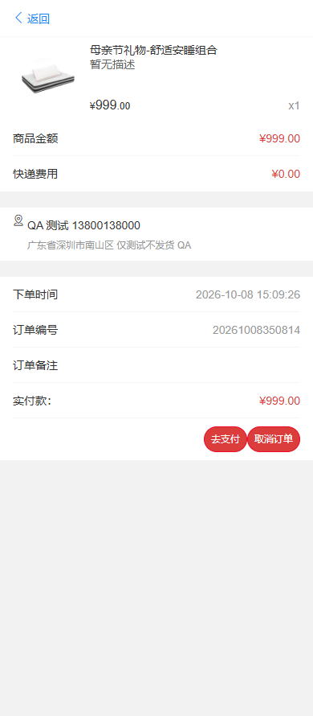

# 真实缺陷报告

所有缺陷都在真实本地litemall执行中发现。严重度为本项目按影响评估；未提交上游Issue，未修复，未声称修复后通过。完整批次4项仍失败。

## BUG-001 购物车缺少number时返回内部错误

严重程度：S3 中。状态：Open；确认重复出现，未修复。

前置条件：独立litemall_qa、后端已启动、专用测试用户、货品1库存100；UI使用真实Chromium。

复现步骤：登录后向POST /wx/cart/add只传goodsId和productId，不传number。

预期：必填缺失返回参数业务错误401，不能触发内部异常。

实际：HTTP200，errno=502。货品库存仍100，未生成购物车。

原因分析：WxCartController.add第122行先cart.getNumber().intValue()，后才执行allNotNull；空值先解引用导致NPE。error.log实际出现该行栈。

建议：先验证number非null和合法范围，再转换；建议补必填字段验证。仅建议，未修改商城。

自动复现：`python -m pytest -k test_missing_cart_number_should_be_validation_error -q`，设置EVIDENCE_DIR后执行。当前预期是失败；不能把实际errno改写为期望值。

证据：`evidence/runs/20261008-150847-all/BUG-001.jsonl`，HTTP/SQL完整关联在同批`http.jsonl`和`sql.jsonl`，JUnit/Allure有失败堆栈。

实际快照：

```json
{"time": "2026-10-08T07:08:57.274543+00:00", "response": {"errno": 502, "errmsg": "系统内部错误"}, "stock": 100}
```

## BUG-002 指定他人的cartId可以创建本人订单并扣减库存

严重程度：S2 高。状态：Open；确认重复出现，未修复。

前置条件：独立litemall_qa、后端已启动、专用测试用户、货品1库存100；UI使用真实Chromium。

复现步骤：B登录并fastadd商品创建购物车；A登录创建本人地址；A向order/submit传B的cartId与A的addressId。

预期：拒绝跨用户购物车；B购物车deleted不变；不创建A订单；不扣库存。

实际：HTTP200，errno=0，创建user_id为A的101订单；B购物车deleted从0变1；库存100降为99。随后fixture通过A的取消接口恢复库存并清理。

原因分析：WxOrderService.submit在非零cartId分支使用cartService.findById(cartId)，未校验userId；对应deleteById同样按id删除。地址与order/detail/cancel有用户约束，但购物车下单入口遗漏。

建议：采用用户与cartId联合查询并验证未删除/合法数量，在创建订单之前拒绝不属于当前用户的数据。未修复。

自动复现：`python -m pytest -k test_submit_foreign_cart_must_be_rejected -q`，设置EVIDENCE_DIR后执行。当前预期是失败；不能把实际errno改写为期望值。

证据：`evidence/runs/20261008-150847-all/BUG-002.jsonl`，HTTP/SQL完整关联在同批`http.jsonl`和`sql.jsonl`，JUnit/Allure有失败堆栈。

实际快照：

```json
{"time": "2026-10-08T07:08:58.275299+00:00", "victim_user": 71, "attacker_user": 70, "cart_id": 23, "cart_before": [{"id": 23, "user_id": 71, "product_id": 1, "number": 1, "deleted": 0}], "cart_after": [{"id": 23, "user_id": 71, "product_id": 1, "number": 1, "deleted": 1}], "orders": [{"id": 15, "user_id": 70, "order_status": 101}], "stock_before": 100, "stock_after": 99, "response": {"errno": 0, "data": {"orderId": 15, "grouponLinkId": 0, "payed": false}, "errmsg": "成功"}}
```

## BUG-003 加购物车允许商品和其他商品的货品错配

严重程度：S2 高。状态：Open；确认重复出现，未修复。

前置条件：独立litemall_qa、后端已启动、专用测试用户、货品1库存100；UI使用真实Chromium。

复现步骤：登录；查商品1181000及其他商品1006002的货品7；向cart/add传goodsId=1181000、productId=7、number=1。

预期：拒绝商品与货品不一致组合，不应保存错误记录。

实际：HTTP200，errno=0；SQL购物车goods_id=1181000但product_id=7，p.goods_id=1006002；商品名为母亲节组合，价格却取另一个货品899.00。

原因分析：WxCartController.add分别查goods与product，只检查在售和库存，未比较product.goodsId与请求goodsId；随后名称取goods，价格取product，形成错配。

建议：服务端验证product.goodsId==goodsId并一致封装名称/价格/规格，拒绝错误关联。未修复。

自动复现：`python -m pytest -k test_mismatched_goods_product_must_be_rejected -q`，设置EVIDENCE_DIR后执行。当前预期是失败；不能把实际errno改写为期望值。

证据：`evidence/runs/20261008-150847-all/BUG-003.jsonl`，HTTP/SQL完整关联在同批`http.jsonl`和`sql.jsonl`，JUnit/Allure有失败堆栈。

实际快照：

```json
{"time": "2026-10-08T07:08:58.742917+00:00", "requested_goods": 1181000, "foreign_product": {"id": 7, "goods_id": 1006002, "price": "899.00", "number": 100}, "stored_cart": [{"id": 24, "goods_id": 1181000, "product_id": 7, "goods_name": "母亲节礼物-舒适安睡组合", "price": "899.00"}], "response": {"errno": 0, "data": 1, "errmsg": "成功"}}
```

## BUG-004 订单详情取消按钮错误调用删除接口

严重程度：S3 中。状态：Open；确认重复出现，未修复。

前置条件：独立litemall_qa、后端已启动、专用测试用户、货品1库存100；UI使用真实Chromium。

复现步骤：准备101待付款订单；真实页面登录；进入/order/order-detail?orderId=<id>；点击取消订单并确认。

预期：调用order/cancel；状态101→102；库存99→100。

实际：实际请求POST /wx/order/delete；响应errno=725“订单不能删除”；SQL状态仍101且库存99。订单列表取消正常，对照测试已通过。

原因分析：Vue views/order/order-detail/index.vue的cancelOrder方法调用orderDelete；同文件已引入orderCancel但没有使用。请求路由、响应和SQL共同确认。

建议：把取消动作连接到orderCancel并补详情页回归；当前仅记录，不改业务。

自动复现：`python -m pytest -k test_ui_detail_cancel_should_cancel_order -q`，设置EVIDENCE_DIR后执行。当前预期是失败；不能把实际errno改写为期望值。

证据：`evidence/runs/20261008-150847-all/BUG-004.jsonl`，HTTP/SQL完整关联在同批`http.jsonl`和`sql.jsonl`，JUnit/Allure有失败堆栈。

实际快照：

```json
{"time": "2026-10-08T07:09:28.229406+00:00", "order_id": 17, "requested_url": "http://127.0.0.1:6255/wx/order/delete", "response": {"errno": 725, "errmsg": "订单不能删除"}, "sql_order": {"id": 17, "user_id": 76, "order_status": 101, "goods_price": "999.00", "freight_price": "0.00", "actual_price": "999.00"}, "stock_before_order": 100, "stock_after_click": 99}
```

失败截图：



Trace：`evidence/runs/20261008-150847-all/ui/test_ui_detail_cancel_should_cancel_order/trace.zip`（脱敏）。

BUG-001日志摘录：`evidence/BUG-001-backend-stack.txt`。数据库实际订单已在teardown清理，报告JSON是执行时的查询结果，不是事后补写的数据库状态。
